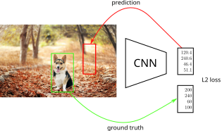
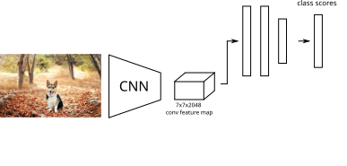
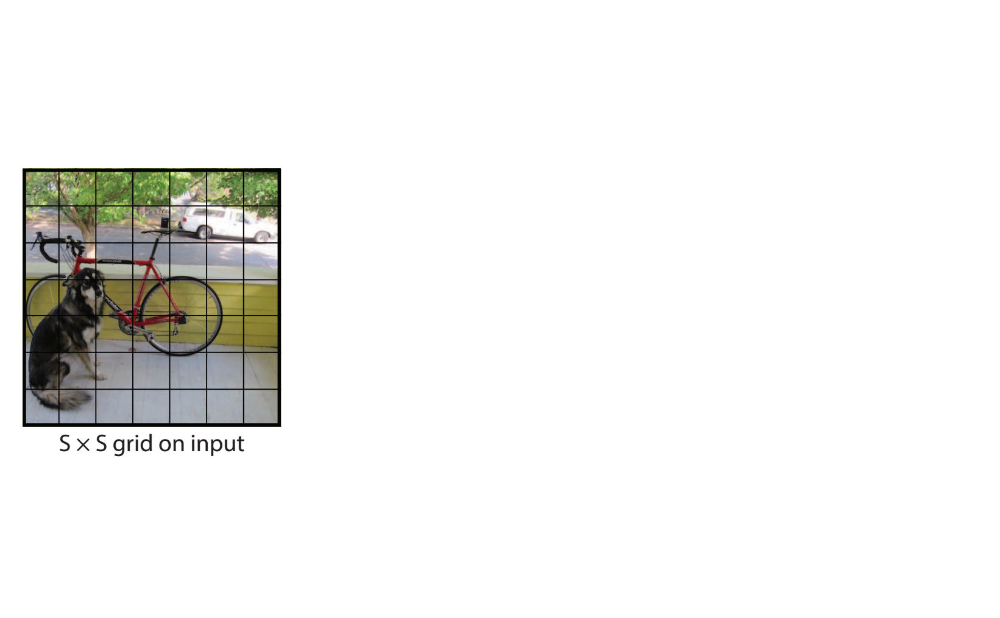
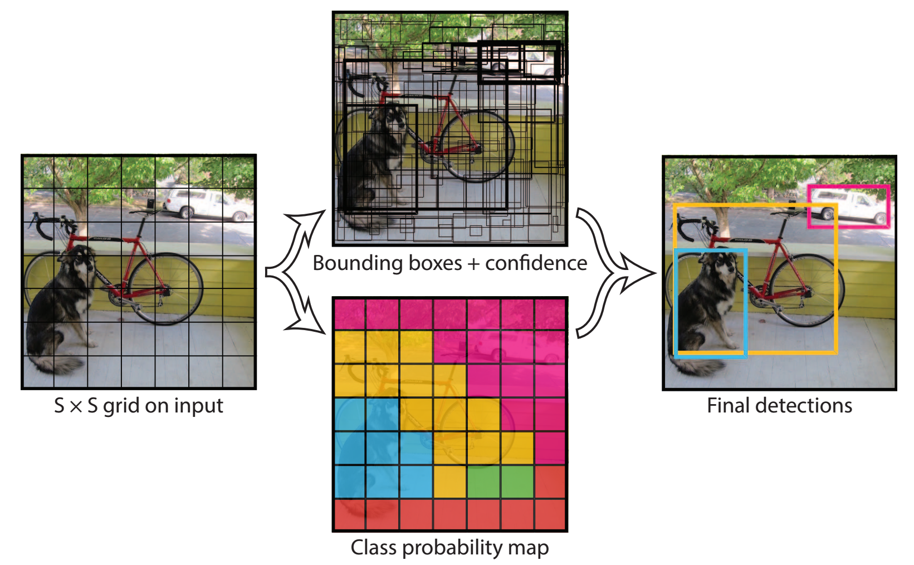
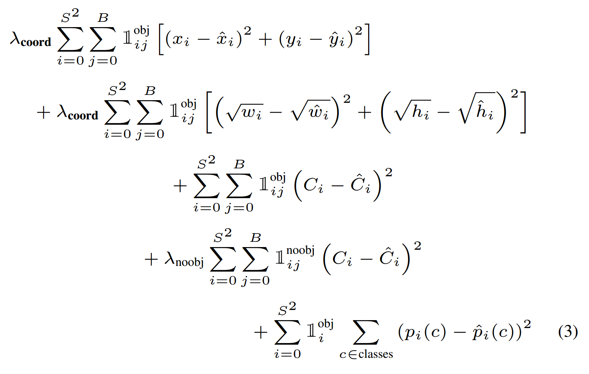
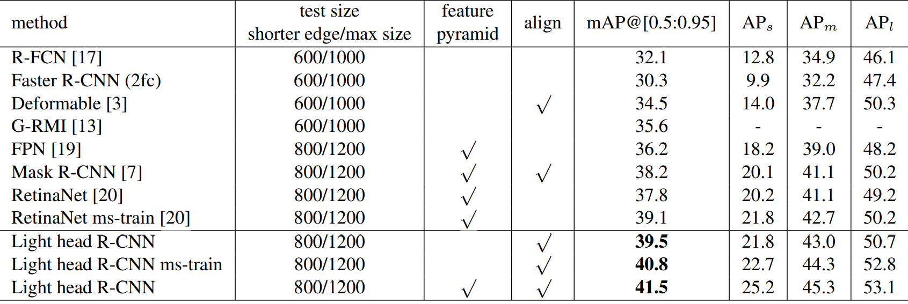

class: center, middle

# Convolutional Neural Networks for Object Detection and Instance Segmentation

Olivier Grisel

`olivier.grisel@inria.fr`

Adapted from [Charles Ollion and Olivier Grisel](https://github.com/m2dsupsdlclass/lectures-labs)

---
# Outline

### Feature Maps and Fully convolutional Networks

--

### Simple Localization as regression

--

### Detection Algorithms

--

*next time*:

### Semantic & Instance Segmentation

---
class: middle, center

# Localization

---
# Localization

.center[
          
]

--

- Single object per image
- Predict coordinates of a bounding box `(x, y, w, h)`

--
- Evaluate via Intersection over Union (IoU)

---
# Localization as regression

.center[
          
]

---
# Localization as regression

.center[
          
]

---
# Classification + Localization

.center[
          
]

---
# Classification + Localization

.center[
          
]

--

- Use a pre-trained CNN on ImageNet (ex. ResNet)
- The "Localization head" is trained separately with regression

--
- Possible end-to-end finetuning of both tasks

--
- At test time, use both heads

---
# Classification + Localization

.center[
          
]

$C$ classes, $4$ output dimensions ($1$ box)

--

**Predict exactly $N$ objects:** predict $(N \times 4)$ coordinates and $(N \times K)$ class scores

---
#Object detection

We don't know in advance the number of objects in the image. Object detection relies on *object proposal* and *object classification*

**Object proposal:** find regions of interest (RoIs) in the image

--

**Object classification:** classify the object in these regions

--

### Two main families:

- Single-Stage: A grid in the image where each cell is a proposal (SSD, YOLO, RetinaNet)
- Two-Stage: Region proposal then classification (Faster-RCNN)

---
# YOLO
.center[
          
]

.footnote.small[
Redmon, Joseph, et al. "You only look once: Unified, real-time object detection." CVPR (2016)
]

--

For each cell of the $S \times S$ predict:
- $B$ **boxes** and **confidence scores** $\text{conf}$ ($5 \times B$ values) + **class probabilities** $p(c)$ for each of the $C$ classes

---
# YOLO
.center[
          
]

For each cell of the $S \times S$ predict:
- $B$ **boxes** and **confidence scores** $\text{conf}$ ($5 \times B$ values) + **class probabilities** $p(c)$ for each of the $C$ classes

.footnote.small[
Redmon, Joseph, et al. "You only look once: Unified, real-time object detection." CVPR (2016)
]
---
# YOLO
.center[
          
]

Final detections: $\text{conf}_j \times p(c) > \text{threshold}$

.footnote.small[
Redmon, Joseph, et al. "You only look once: Unified, real-time object detection." CVPR (2016)
]

---
# YOLO

.footnote.small[
Redmon, Joseph, et al. "You only look once: Unified, real-time object detection." CVPR (2016)
]

- After ImageNet pretraining, the whole network is trained end-to-end

--
- The loss is a weighted sum of different regressions

.center[
          
]

---
# RetinaNet

.center[
          
]

.footnote.small[
Lin, Tsung-Yi, et al. "Focal loss for dense object detection." ICCV 2017.
]

--

Single stage detector with:
- Multiple scales through a *Feature Pyramid Network*
- Focal loss to manage imbalance between background and real objects

--

See the [RetinaNet](https://arxiv.org/abs/1708.02002) and [Feature Pyramid Network](https://arxiv.org/abs/1612.03144) papers for more information

---
# Box proposals

Instead of having a fixed set of box proposals, learn to find them on the image:

**Region Proposal Network**

- Input: coarse convolutional feature map
- Output: at each location of the feature map, for each of $k$ predefined **anchor boxes**: an objectness score and box coordinate offsets
- Keep only the top $N$ boxes (after non-maximum suppression) as regions of interest

--

**Crop-and-resize** the feature map to feed positively classified boxes to a classification network
- Using a dedicated "RoI pooling" / "RoI align" layer
- Allows to share the backbone computation and to train the head only on a sampled subset of regions

---
# Faster-RCNN

.center[
          
]

.footnote.small[
Ren, Shaoqing, et al. "Faster r-cnn: Towards real-time object detection with region proposal networks." NIPS 2015
]

--

- Train jointly **RPN** and the classification head

--
- A few hundred box proposals (e.g. 300 in the paper) are kept at test time
- The head is trained on a sample of positive and negative (background) proposals; the box regression loss only applies to positive ones

???
Region proposal input is a fully convolutional network: shares weights across spatial dimensions

---
# Instance Segmentation with Mask R-CNN

.center[
          
]

.footnote.small[
He, Kaiming, et al. "Mask R-CNN." International Conference on Computer Vision (ICCV), 2017.
]

--

Faster-RCNN architecture with a third, binary mask head
---
# Instance Segmentation with Mask R-CNN

.center[
          
]

.footnote.small[
He, Kaiming, et al. "Mask R-CNN." International Conference on Computer Vision (ICCV), 2017.
]

--

- Mask results are still coarse (low mask resolution)
- Excellent instance generalization

---
# Instance Segmentation with Mask R-CNN

.center[
          
]

.footnote.small[
He, Kaiming, et al. "Mask R-CNN." International Conference on Computer Vision (ICCV), 2017.
]

---
## Measuring performance

.center[
          
]

Measures: mean Average Precision **mAP** at given **IoU** thresholds

- Average Precision: area under the Precision-Recall curve for one class and on IoU threshold.

.footnote.small[
Zeming Li et al. Light-Head R-CNN: In Defense of Two-Stage Object Detector 2017
]

--

- AP @0.5 for class "cat": average precision for the class, where $IoU(box^{pred}, box^{true}) > 0.5$

--

- mAP: average AP values for all classes.

---
## State-of-the-art

- Larger image sizes, larger and better models
- New architectures: transformers with DETR/DINO losses, deformable convolutions...
- Better augmented data, unsupervised pretraining
- Dataset curation
- https://huggingface.co/models?pipeline_tag=object-detection&sort=trending

---
## Take away NN for Vision

### Pre-trained features as a basis

- ImageNet: centered objects, very broad image domain
- 1M+ labels and many different classes resulting in very **general** and **disentangling** representations
- Better Networks (i.e. ResNet vs VGG) have **a huge impact**
- Recent alternatives: self-supervised learning (more on this later)

--

### Transfer learning and fine tuning

Goal: make use of a smaller dataset but with richer labels:

- object bounding boxes, object classes, instance masks...

--

Steps:

- Remove the last layer(s) of a model pretrained on ImageNet (for instance)
- Add new layers that match the output shape of the new labels
- **Transfer learning**: fit only the last layers to the new dataset
- or **Fine tune** the whole architecture end-to-end
