class: center, middle

# Convolutional Neural Networks for Object Detection and Instance Segmentation

Olivier Grisel

`olivier@probabl.ai`

Adapted from [Charles Ollion and Olivier Grisel](https://github.com/m2dsupsdlclass/lectures-labs)

---
# Recap: Semantic Segmentation

- Fully convolutional networks: one class probability per pixel, for any image size
- Transposed convolutions and skip connections (U-Net): recover fine spatial resolution
- Strided operations downscale the feature maps (typically $32\times$): small objects get few cells

--

### What is still missing
- Object instances are not separated: two cats form one blob
- No box or position is given for each object

---
# Object Detection

.center[
          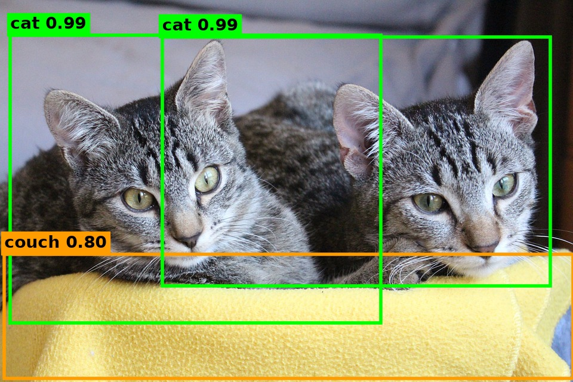
]

One box and one class for each object: *where* is each object?

---
# Outline

### Simple Localization as regression

--

### Detection Algorithms

--

### Instance Segmentation

--

### Measuring Performance

---
class: middle, center

# Localization

---
# Localization

.center[
          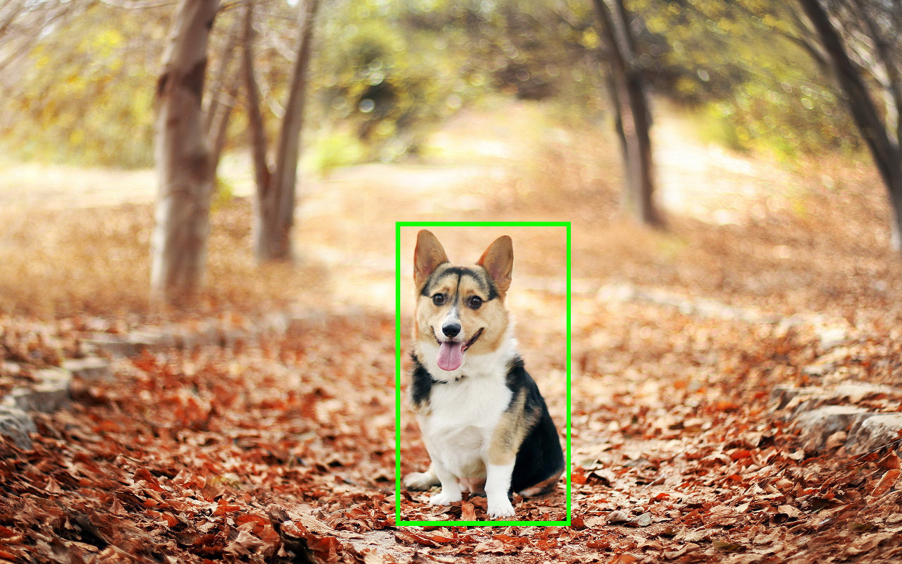
]

--

- Single object per image
- Predict coordinates of a bounding box `(x, y, w, h)`

--
- Evaluate via Intersection over Union (IoU)

---
# Intersection over Union (IoU)

.center[
          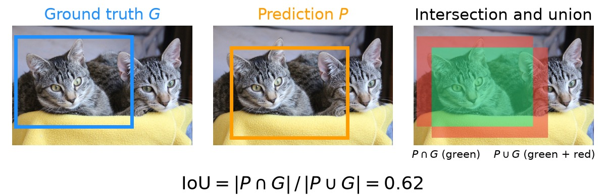
]

.footnote.small[
Illustration: the predicted box is the ground truth box shifted by a few pixels. Same definition as for segmentation masks.
]

--

$$\mathrm{IoU} = \frac{|P \cap G|}{|P \cup G|} = \frac{\text{area of the overlap}}{\text{area of the union}}$$

--

- **Higher is better**: from $0$ (no overlap) to $1$ (perfect match)
- A predicted box is usually considered correct if $\mathrm{IoU} > 0.5$

---
# Localization as regression

.center[
          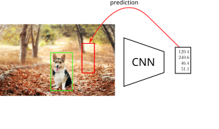
]

---
# Localization as regression

.center[
          
]

---
# Classification + Localization

.center[
          
]

---
# Classification + Localization

.center[
          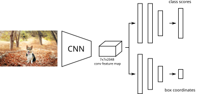
]

--

- Use a pre-trained CNN on ImageNet (ex. ResNet)
- The "Localization head" is trained separately with regression

--
- Possible end-to-end finetuning of both tasks

--
- At test time, use both heads

---
# Classification + Localization

.center[
          
]

$C$ classes, $4$ output dimensions ($1$ box)

--

**Predict exactly $N$ objects:** predict $(N \times 4)$ coordinates and $(N \times K)$ class probabilities

---
# Training Objective

For one object, with predicted class probabilities $\hat{p}$, true class $c$, predicted box $\hat{b}$ and true box $b$:

$$\mathcal{L} = \underbrace{-\log \hat{p}\_c}\_{\text{classification}} + \lambda \, \underbrace{\mathcal{L}\_{box}(\hat{b}, b)}\_{\text{localization}}$$

--

- **Classification**: cross-entropy, as for image classification
- **Localization**: regression loss on the box coordinates $(x, y, w, h)$, for instance L2, L1 or smooth L1
- $\lambda$ balances the two terms

--

**Lower is better**: the two heads are trained to minimize this loss

---
class: middle, center

# Detection Algorithms

---
# From Localization to Detection

We don't know in advance the number of objects in the image. Object detection relies on *object proposal* and *object classification*

**Object proposal:** find regions of interest (RoIs) in the image

--

**Object classification:** classify the object in these regions

--

### Two main families:

- Single-Stage: A grid in the image where each cell is a proposal (SSD, YOLO, RetinaNet)
- Two-Stage: Region proposal then classification (Faster-RCNN)

---
# YOLO
.center[
          
]

.footnote.small[
Redmon, Joseph, et al. "You only look once: Unified, real-time object detection." CVPR (2016)
]

--

For each cell of the $S \times S$ predict:
- $B$ **boxes** and **box confidences** $\text{conf}$ ($5 \times B$ values) + **class probabilities** $p(c)$ for each of the $C$ classes

---
# YOLO
.center[
          
]

For each cell of the $S \times S$ predict:
- $B$ **boxes** and **box confidences** $\text{conf}$ ($5 \times B$ values) + **class probabilities** $p(c)$ for each of the $C$ classes

--

Final detections: $\text{conf}_j \times p(c) > \text{threshold}$

.footnote.small[
Redmon, Joseph, et al. "You only look once: Unified, real-time object detection." CVPR (2016)
]

---
# YOLO

.footnote.small[
Redmon, Joseph, et al. "You only look once: Unified, real-time object detection." CVPR (2016)
]

- After ImageNet pretraining, the whole network is trained end-to-end

--
- The loss is a weighted sum of different regressions

.center[
          
]

---
# Non-Maximum Suppression (NMS)

.center[
          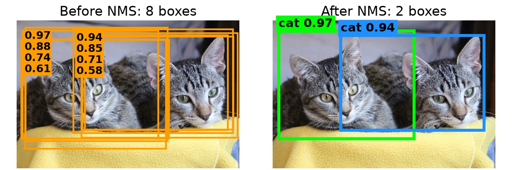
]

.footnote.small[
Illustration: the redundant boxes are simulated by jittering the ground truth boxes.
]

--

Detectors output several overlapping boxes for the same object. For each class:

1. Keep the box with the highest predicted confidence
2. Suppress the boxes whose $\mathrm{IoU}$ with it is above a threshold (for instance $0.5$)
3. Repeat with the remaining boxes

--

Boxes of different objects overlap less, so they are kept.

---
# Anchor Boxes

.center[
          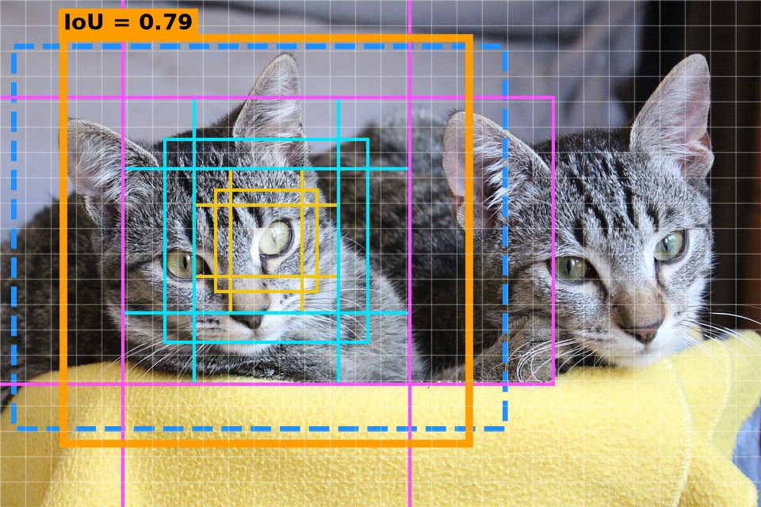
]

.footnote.small[
Anchors at one location of a feature map with stride $32$: $3$ scales and $3$ aspect ratios. Dashed blue: ground truth box.
]

--

- At each location of the feature map: $k$ **anchor boxes** with predefined sizes and aspect ratios ($k = 9$ here)
- The network predicts for each anchor an objectness score (object or background) and offsets that refine the box

--

- In training, an anchor is **positive** if its $\mathrm{IoU}$ with a ground truth box is high enough (orange: $0.79$ with the left cat)

---
# RetinaNet

.center[
          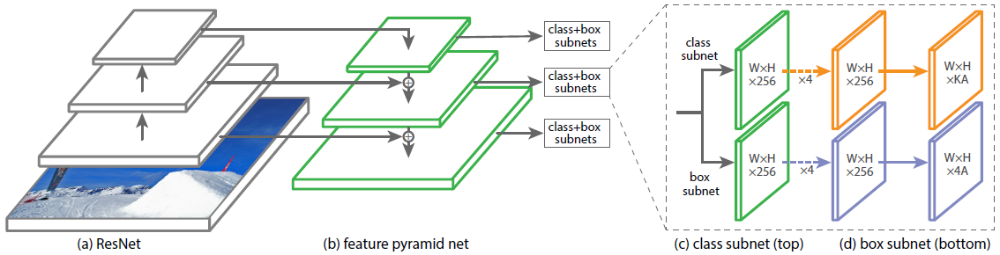
]

.footnote.small[
Lin, Tsung-Yi, et al. "Focal loss for dense object detection." ICCV 2017. More information: [RetinaNet](https://arxiv.org/abs/1708.02002) and [Feature Pyramid Network](https://arxiv.org/abs/1612.03144) papers.
]

--

Single stage detector with:
- Multiple scales through a *Feature Pyramid Network*: a top-down path with lateral connections, as the U-Net skip connections
- Focal loss to manage imbalance between background and real objects

--

**Better than SSD and YOLO for objects of different sizes:**
- YOLO (v1): one coarse grid, so small objects get few cells
- SSD: several scales, but its early maps have weak semantic features
- FPN: every scale gets strong semantic features

---
# Box proposals

Instead of having a fixed set of box proposals, learn to find them on the image:

**Region Proposal Network**

- Input: coarse convolutional feature map
- Output: at each location of the feature map, for each of $k$ predefined **anchor boxes**: an objectness score and box coordinate offsets
- Keep only the top $N$ boxes (after non-maximum suppression) as regions of interest

--

**Crop-and-resize** the feature map to feed positively classified boxes to a classification network
- Using a dedicated "RoI pooling" / "RoI align" layer
- Allows to share the backbone computation and to train the head only on a sampled subset of regions

---
# Faster-RCNN

.center[
          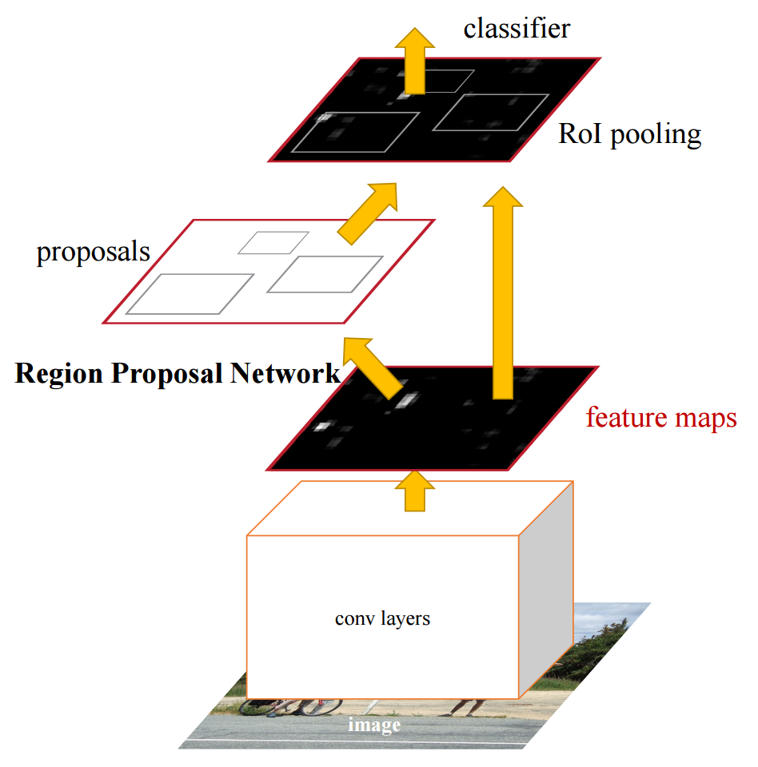
]

.footnote.small[
Ren, Shaoqing, et al. "Faster r-cnn: Towards real-time object detection with region proposal networks." NIPS 2015
]

--

- Train jointly **RPN** and the classification head

--
- A few hundred box proposals (e.g. 300 in the paper) are kept at test time
- The head is trained on a sample of positive and negative (background) proposals; the box regression loss only applies to positive ones

???
Region proposal input is a fully convolutional network (see the previous lecture): shares weights across spatial dimensions

---
# DETR: Set Prediction

.center[
          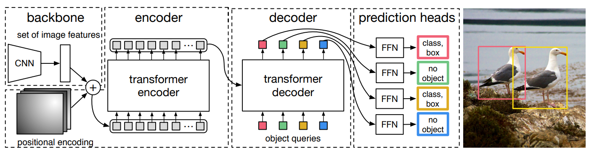
]

.footnote.small[
Carion, Nicolas, et al. "End-to-end object detection with transformers." ECCV 2020
]

--

- A fixed set of $N$ learned **object queries**: each one predicts a box and a class, or "no object"
- No anchors and no NMS: the training loss discourages duplicate predictions

--

The **transformer** blocks and the encoder/decoder architecture are explained in future lectures

---
# Training Objective for Detection

Each anchor or region proposal is matched to the ground truth with the $\mathrm{IoU}$:

- **Positive** if $\mathrm{IoU} > 0.5$ with a ground truth box: class and box targets
- **Negative** if $\mathrm{IoU} < 0.4$ with all the boxes: class "background"

--

$$\mathcal{L} = \sum\_{i} \mathcal{L}\_{cls}(\hat{p}\_i, c\_i) + \lambda \sum\_{i \in \text{positives}} \mathcal{L}\_{box}(\hat{b}\_i, b\_i)$$

--

- $\mathcal{L}\_{cls}$: cross-entropy (focal loss in RetinaNet), $\mathcal{L}\_{box}$: smooth L1
- **Lower is better**

---
class: middle, center

# Instance Segmentation

---
# Instance Segmentation

.center[
          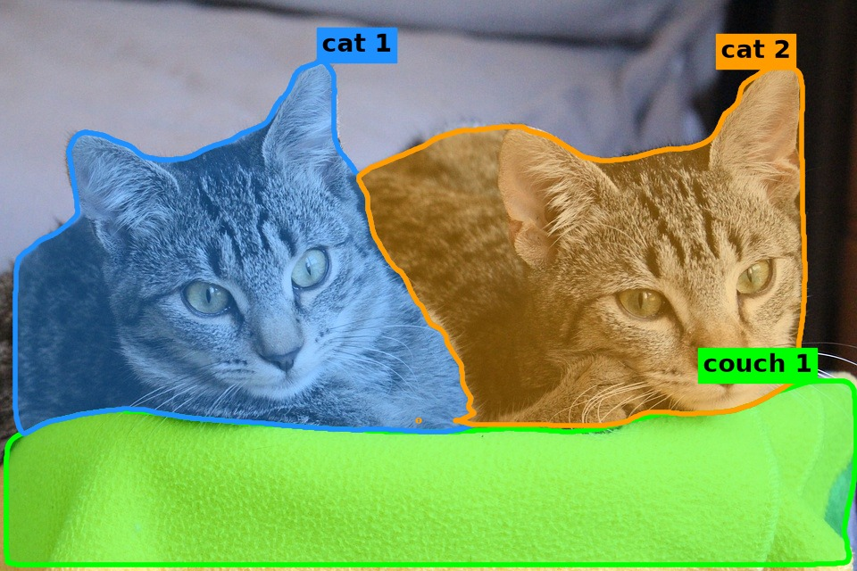
]

One mask and one class for each object: *which pixels* belong to each object?

--

- Unlike semantic segmentation, the two cats are two instances
- **Panoptic segmentation** combines both (see the previous lecture)

--
- Can be done with **object detection** + a **mask** for each detected box

---
# Mask R-CNN

.center[
          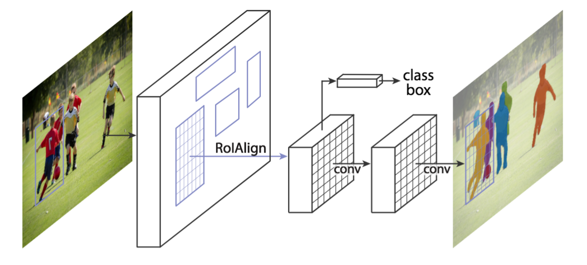
]

.footnote.small[
He, Kaiming, et al. "Mask R-CNN." International Conference on Computer Vision (ICCV), 2017.
]

--

Faster-RCNN architecture with a third, binary mask head
---
# Mask R-CNN

.center[
          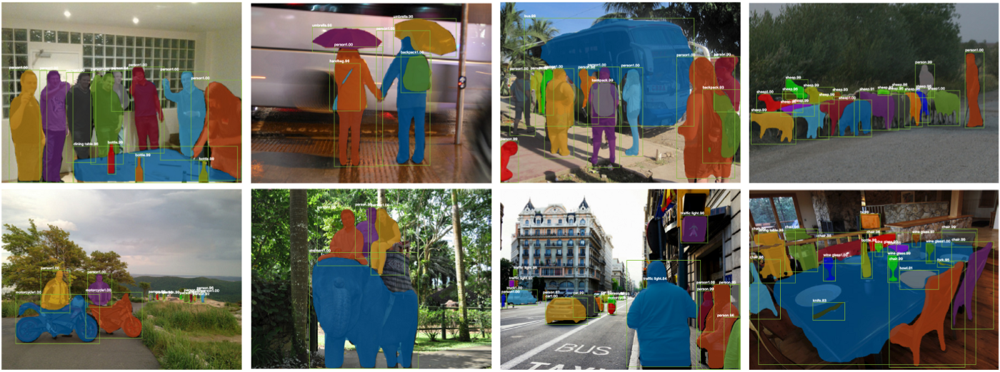
]

.footnote.small[
He, Kaiming, et al. "Mask R-CNN." International Conference on Computer Vision (ICCV), 2017.
]

--

- Mask results are still coarse: the mask head predicts a small mask ($28 \times 28$) for each box
- Excellent instance generalization

---
# Mask R-CNN

.center[
          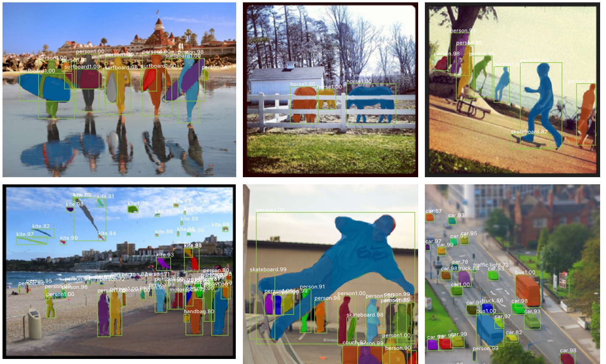
]

.footnote.small[
He, Kaiming, et al. "Mask R-CNN." International Conference on Computer Vision (ICCV), 2017.
]

---
class: middle, center

# Measuring Performance

---
# Precision and Recall

For one class, a predicted box is a **true positive** (TP) if its class is right and its $\mathrm{IoU}$ with a ground truth box not matched yet is above a threshold (for instance $0.5$). Otherwise it is a **false positive** (FP). A ground truth object that is not matched is a **false negative** (FN).

--

$$\mathrm{Precision} = \frac{TP}{TP + FP} \qquad \mathrm{Recall} = \frac{TP}{TP + FN}$$

--

- **Precision**: which fraction of the predicted boxes are correct?
- **Recall**: which fraction of the ground truth objects are found?
- **Higher is better** for both

---
# Average Precision (AP)

.center[
          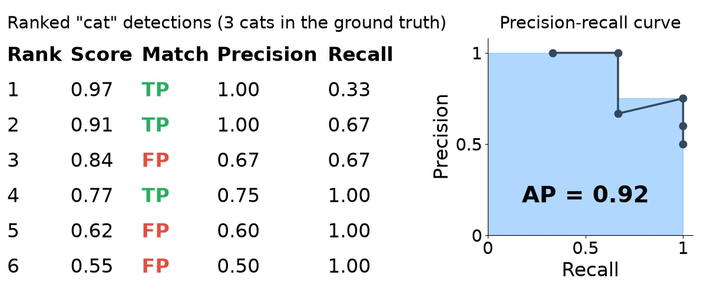
]

--

- Sort the detections of one class by decreasing confidence: each rank gives one point (recall, precision)
- $\mathrm{AP}$ is the area under the precision envelope of this curve: **higher is better**, from $0$ to $1$

---
# Mean Average Precision (mAP)

$$\mathrm{mAP} = \frac{1}{C} \sum\_{c=1}^{C} \mathrm{AP}\_c$$

--

- Compute the AP of each class $c$ separately, then average these $C$ values over all the classes

--

- **Higher is better**, from $0$ to $1$
- COCO benchmark: AP averaged over $10$ IoU thresholds, from $0.5$ to $0.95$ (mAP@[0.5:0.95])
- Also reported for small, medium and large objects: $\mathrm{AP}\_s$, $\mathrm{AP}\_m$, $\mathrm{AP}\_l$

--

- Instance segmentation: same metric with the $\mathrm{IoU}$ of the masks instead of the boxes (mask AP)

---
# Results on COCO

.center[
          
]

.footnote.small[
Zeming Li et al. Light-Head R-CNN: In Defense of Two-Stage Object Detector 2017
]

--

- Metric: mAP@[0.5:0.95], higher is better
- Small objects are the hardest: $\mathrm{AP}\_s$ is much lower than $\mathrm{AP}\_l$ for all the methods

---
# Panoptic Quality (PQ)

For panoptic segmentation, a predicted and a ground truth segment match if their $\mathrm{IoU}$ is above $0.5$:

$$\mathrm{PQ} = \frac{\sum\_{(p, g) \in \mathrm{TP}} \mathrm{IoU}(p, g)}{|\mathrm{TP}| + \frac{1}{2}|\mathrm{FP}| + \frac{1}{2}|\mathrm{FN}|}$$

--

- Numerator: $\mathrm{IoU}$ of the matched segments. Denominator: also penalizes the predicted segments without match (FP) and the ground truth segments without match (FN)
- **Higher is better**, from $0$ to $1$

.footnote.small[
Kirillov et al., "Panoptic Segmentation", CVPR 2019
]

---
# State-of-the-art

- Larger image sizes, larger and better models
- New architectures: transformers with DETR/DINO losses, deformable convolutions...
- Better augmented data, unsupervised pretraining
- Dataset curation
- https://huggingface.co/models?pipeline_tag=object-detection&sort=trending

--

 

### PyTorch

Detectron2 https://github.com/facebookresearch/detectron2

- Mask R-CNN, RetinaNet and other architectures
- Also available in `torchvision.models.detection`

---
# Takeaways

- **Detection**: one box and one class per object, from region proposals or from a dense grid of anchors
- **Single-stage** (YOLO, RetinaNet) vs **two-stage** (Faster R-CNN): a trade-off between speed and accuracy
- **IoU** is used in training and in evaluation, with a different role:
  - **Training**: computed between each anchor box (or region proposal) and the ground truth box, then compared to a threshold to select the loss terms: the box regression term is only included for the anchors above it
  - **Evaluation**: computed between the predicted box (or mask) and the ground truth box (or mask): a detection above the threshold is a true positive
- **NMS** removes redundant predicted boxes
- **Instance segmentation**: detection plus a mask head (Mask R-CNN), **panoptic segmentation** adds the regions of the rest
- **Evaluation**: AP per class averaged into mAP over IoU thresholds, higher is better
