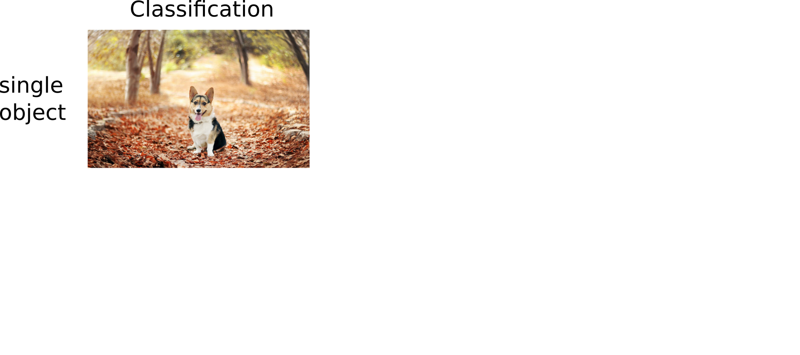
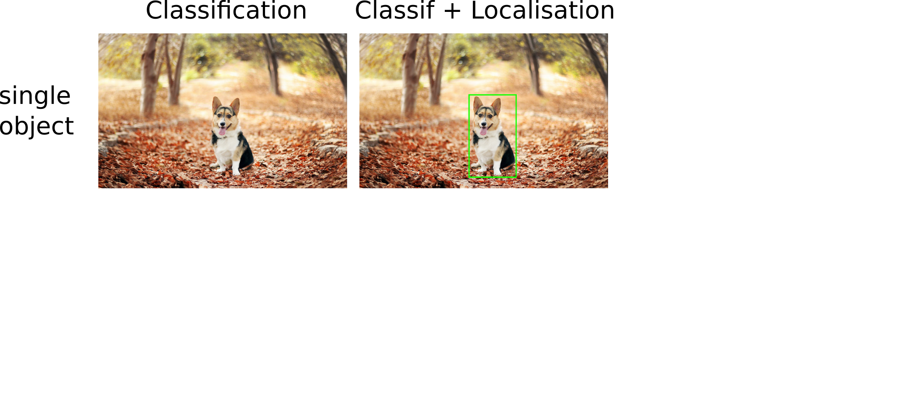
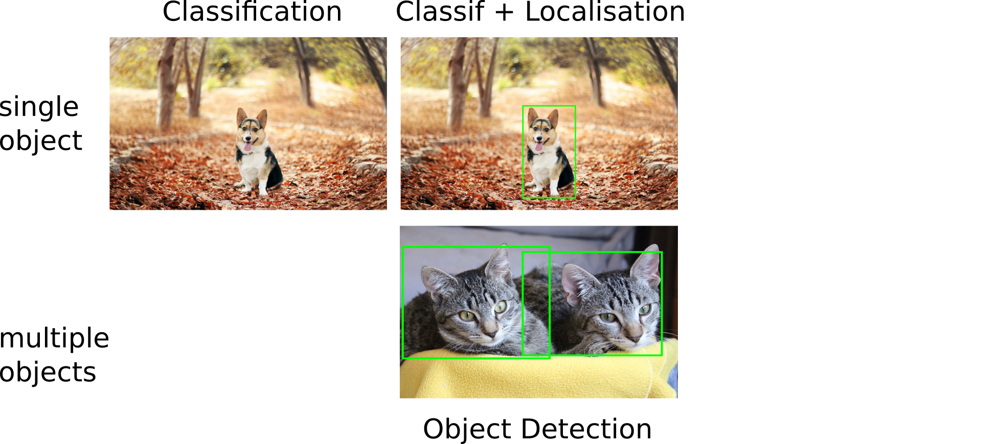
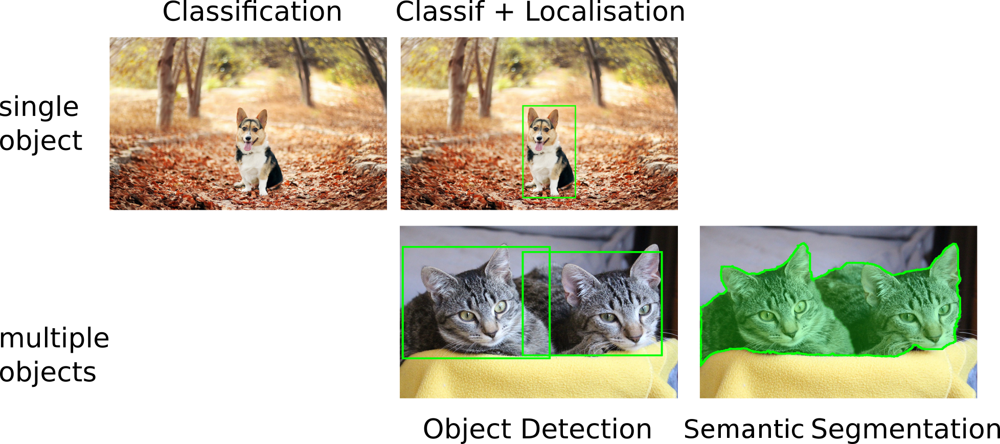
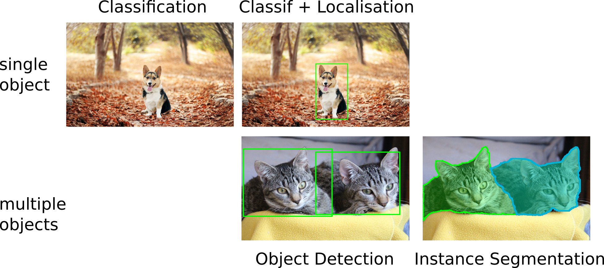
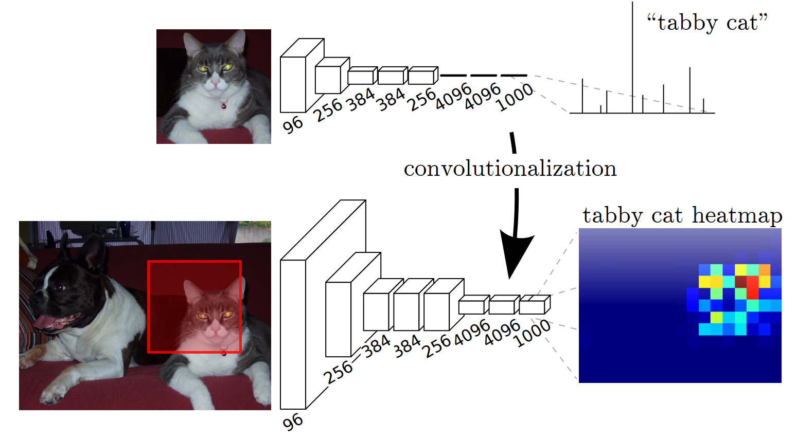

class: center, middle

# Convolutional Neural Networks for Semantic Segmentation

Olivier Grisel

`olivier.grisel@inria.fr`

Adapted from [Charles Ollion and Olivier Grisel](https://github.com/m2dsupsdlclass/lectures-labs)

---
# CNNs for computer Vision

.center[
          
]

---
# Beyond Image Classification

### CNNs
- Previous lecture: image classification

--

### Limitations
- Mostly on centered images
- Only a single object per image
- Not enough for many real world vision tasks

---
# Beyond Image Classification

.center[
           
          
]

---
# Beyond Image Classification

.center[
           
          
]
---
# Beyond Image Classification

.center[
           
          
]
---
# Beyond Image Classification

.center[
           
          
]
---
# Beyond Image Classification

.center[
           
          
]

---
# Segmentation

Output a class map for each pixel (here: dog vs background)

.center[
          
]

--

- **Semantic segmentation**: full image, pixel-wise classification

--

  - No object detection

--

- **Instance segmentation**: specify each object instance as well (two dogs have different instances)

--
  - This can be done through **object detection** + **segmentation**

---
class: middle, center

# Feature Maps and Fully Convolutional Networks

---
# Convolutionization of a Classification Network

.center[
  
]

.footnote.small[
Long, Jonathan, et al. "Fully convolutional networks for semantic segmentation." CVPR 2015
]

- Slide the network with an input of `(224, 224)` over a larger image. Output of varying spatial size
--

- **Convolutionize**: 

   - remove global average pooling and flattening layers
   - replace `Linear(2048, 1000)` to $1 \times 1$ `Conv2d(2048, 1000, kernel_size=1)`

???
output map upscaled from fully convolutional network

---
# Fully Convolutional Network

.center[
          
]

.footnote.small[
Long, Jonathan, et al. "Fully convolutional networks for semantic segmentation." CVPR 2015
]

--

- Predict / backpropagate for every output pixel

--
- Aggregate maps from several convolutions at different scales for more robust results

---
# Segmentation with Transposed Convolutions

.center[
          
]

.footnote.small[
Noh, Hyeonwoo, et al. "Learning deconvolution network for semantic segmentation." ICCV 2015
]

--

- **Transposed convolutions** (sometimes called "deconvolutions", e.g. in the paper above) learn to **upsample** feature maps
- Despite the name, they do not invert a convolution: they only restore the spatial resolution

.center[
          
]

--
- **Sharper masks** by using precise spatial information (first and last layers).

--
- **Global context 'understanding'** by extracting semantics of coarser regions (middle layers).

---
# Image Segmentation with U-Nets

.center[
          
]

.footnote.small[
Ronneberger, Olaf et al., "U-Net: Convolutional Networks for Biomedical Image Segmentation", MICCAI 2015
]

--
- **Skip connections** between corresponding convolution and transposed convolution layers

--
- Copy and concatenate the last feature map of the same resolution to the output of the matching transposed convolution layer.

---
## State-of-the-art & links

Recent models and checkpoints for segmentation can be browsed here:

.center[
https://huggingface.co/tasks/image-segmentation
]

--

 

### Pytorch

Detectron2 https://github.com/facebookresearch/detectron2

- Mask-RCNN, Retina Net and other architectures
- Focal loss, Feature Pyramid Networks, etc.
