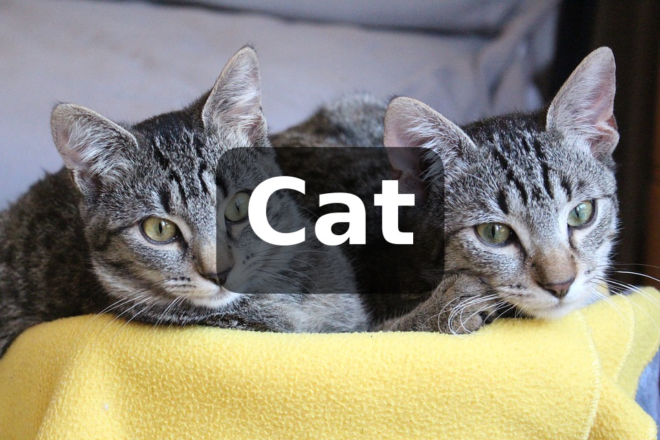
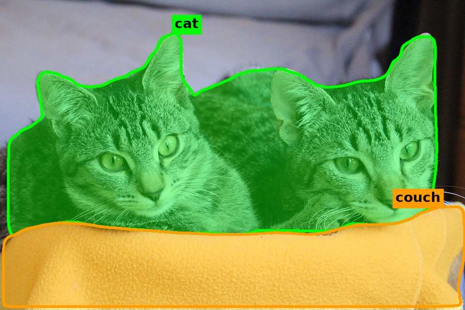

class: center, middle

# Convolutional Neural Networks for Semantic Segmentation

Olivier Grisel

`olivier.grisel@inria.fr`

Adapted from [Charles Ollion and Olivier Grisel](https://github.com/m2dsupsdlclass/lectures-labs)


---
# CNNs for computer Vision

.center[
          
]

---
# Beyond Image Classification

### CNNs
- Previous lecture: image classification

--

### Limitations
- Mostly on centered images
- A single label for the whole image: no idea of where the objects are
- Not enough for many real world vision tasks

---
# Image Classification

.center[
          
]

One label for the whole image: *what* is in the image?

---
# Semantic Segmentation

.center[
          
]

One class for each pixel: *which pixels* belong to each class?

--

- No notion of object: the two cats are merged in a single region

---
# Object Detection

.center[
          
]

Next lecture: one box and one class for each object, *where* is each object?

---
# Instance Segmentation

.center[
          
]

Next lecture: one mask and one class for each object, *which pixels* belong to each object?


---
class: middle, center

# Feature Maps and Fully Convolutional Networks

---
# Convolutionization of a Classification Network

.center[
  
]

.footnote.small[
Long, Jonathan, et al. "Fully convolutional networks for semantic segmentation." CVPR 2015
]

- Slide the network with an input of `(224, 224)` over a larger image. Output of varying spatial size
--

- **Convolutionize**: 

   - remove global average pooling and flattening layers
   - replace `Linear(2048, 1000)` to $1 \times 1$ `Conv2d(2048, 1000, kernel_size=1)`


???
output map upscaled from fully convolutional network

---
# Fully Convolutional Network

.center[
          
]

.footnote.small[
Long et al. (CVPR 2015), see the previous slide
]

--

- Predict / backpropagate for every output pixel

--
- Aggregate maps from several convolutions at different scales for more robust results

---
# Limitation: Coarse Resolution

- **Max pooling** and **strided convolutions** downscale the feature maps: the output is typically $32\times$ smaller than the input

--

- A $224 \times 224$ input gives a $7 \times 7$ output map: each output cell covers a $32 \times 32$ block of pixels

--

- A high resolution segmentation mask is **impossible** to predict directly from such a coarse map

--

- Upsampling it gives blurry masks: small objects and thin structures are lost

--

- We need to **upsample** the feature maps back to the input resolution

---
# Downscaling in a ResNet

.center[
          
]

.footnote.small[
ResNet-50 (He et al., CVPR 2016) on a $224 \times 224$ image. Height: spatial resolution, width: number of channels.
]

--

- Each operation with **stride 2** divides the resolution by 2

--

- 5 such operations: $2^5 = 32\times$ smaller feature maps than the input image

---
# Inspecting a Pretrained ResNet

Load a pretrained ResNet-18 from the Hugging Face Hub with `timm` and print its layers with `torchinfo`:

```py
import timm
from torchinfo import summary

model = timm.create_model("hf-hub:timm/resnet18.a1_in1k", pretrained=True)
summary(model, input_size=(1, 3, 224, 224))
```

.footnote.small[
Requires `pip install timm torchinfo`
]

---
# Where the Downscaling Happens

```text
Layer (type:depth-idx)                   Output Shape              Param #
ResNet                                   [1, 1000]                 --
├─Conv2d: 1-1                            [1, 64, 112, 112]         9,408
├─BatchNorm2d: 1-2                       [1, 64, 112, 112]         128
├─ReLU: 1-3                              [1, 64, 112, 112]         --
├─MaxPool2d: 1-4                         [1, 64, 56, 56]           --
├─Sequential: 1-5                        [1, 64, 56, 56]           --
...
├─Sequential: 1-6                        [1, 128, 28, 28]          --
│    └─BasicBlock: 2-3                   [1, 128, 28, 28]          --
│    │    └─Conv2d: 3-17                 [1, 128, 28, 28]          73,728
...
├─Sequential: 1-7                        [1, 256, 14, 14]          --
│    └─BasicBlock: 2-5                   [1, 256, 14, 14]          --
│    │    └─Conv2d: 3-34                 [1, 256, 14, 14]          294,912
...
├─Sequential: 1-8                        [1, 512, 7, 7]            --
│    └─BasicBlock: 2-7                   [1, 512, 7, 7]            --
│    │    └─Conv2d: 3-51                 [1, 512, 7, 7]            1,179,648
...
├─SelectAdaptivePool2d: 1-9              [1, 512]                  --
│    └─AdaptiveAvgPool2d: 2-9            [1, 512, 1, 1]            --
├─Linear: 1-10                           [1, 1000]                 513,000
```

.footnote.small[
Stride 2: Conv2d 1-1, MaxPool2d 1-4, and the first Conv2d of stages 2, 3 and 4 (3-17, 3-34, 3-51). ResNet-18 has the same strides as ResNet-50, with fewer channels.
]

---
# Transposed Convolutions

.center[
          
]

.footnote.small[
Noh, Hyeonwoo, et al. "Learning deconvolution network for semantic segmentation." ICCV 2015
]

--

- **Transposed convolutions** ("deconvolutions" in the paper above) learn to **upsample** feature maps, without inverting a convolution

.center[
          
]

--
- **Sharper masks** by using precise spatial information (first and last layers).

--
- **Global context 'understanding'** by extracting semantics of coarser regions (middle layers).

---
# Image Segmentation with U-Nets

.center[
          
]

.footnote.small[
Ronneberger, Olaf et al., "U-Net: Convolutional Networks for Biomedical Image Segmentation", MICCAI 2015
]

--
- **Skip connections** between matching encoder and decoder layers

--
- Copy and concatenate the last feature map of the same resolution to the output of the matching transposed convolution layer.


---
## State-of-the-art & links

Recent models and checkpoints for segmentation can be browsed here:

.center[
https://huggingface.co/tasks/image-segmentation
]

--

Next lecture: object detection and instance segmentation
