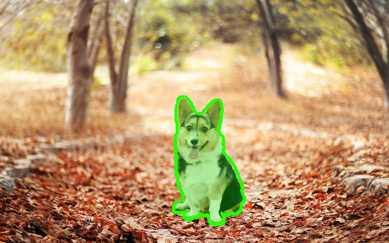
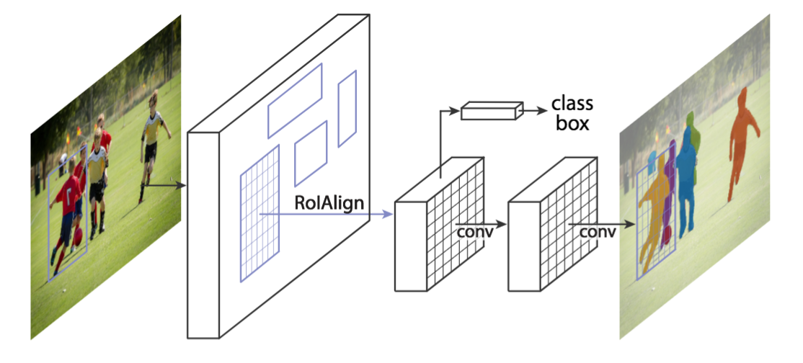
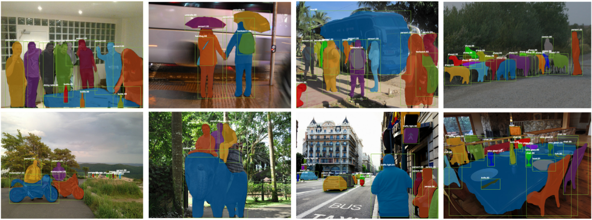
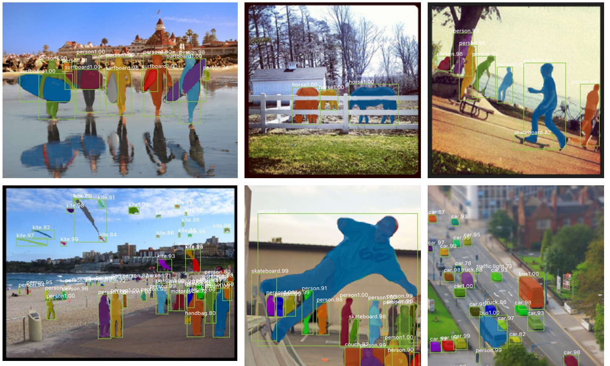

class: center, middle

# Convolutional Neural Networks for Semantic and Instance Segmentation

Olivier Grisel

`olivier.grisel@inria.fr`

Adapted from [Charles Ollion and Olivier Grisel](https://github.com/m2dsupsdlclass/lectures-labs)

---
# Segmentation

Output a class map for each pixel (here: dog vs background)

.center[
          
]

--

- **Semantic segmentation**: full image, pixel-wise classification

--

  - No object detection

--

- **Instance segmentation**: specify each object instance as well (two dogs have different instances)

--
  - This can be done through **object detection** + **segmentation**

---
# Fully Convolutional Network

.center[
          
]

.footnote.small[
Long, Jonathan, et al. "Fully convolutional networks for semantic segmentation." CVPR 2015
]

--

- Predict / backpropagate for every output pixel

--
- Aggregate maps from several convolutions at different scales for more robust results

---
# Segmentation with Transposed Convolutions

.center[
          
]

.footnote.small[
Noh, Hyeonwoo, et al. "Learning deconvolution network for semantic segmentation." ICCV 2015
]

--

- **Transposed convolutions** (sometimes called "deconvolutions", e.g. in the paper above) learn to **upsample** feature maps
- Despite the name, they do not invert a convolution: they only restore the spatial resolution

.center[
          
]

--
- **Sharper masks** by using precise spatial information (first and last layers).

--
- **Global context 'understanding'** by extracting semantics of coarser regions (middle layers).

---
# Image Segmentation with U-Nets

.center[
          
]

.footnote.small[
Ronneberger, Olaf et al., "U-Net: Convolutional Networks for Biomedical Image Segmentation", MICCAI 2015
]

--
- **Skip connections** between corresponding convolution and transposed convolution layers

--
- Copy and concatenate the last feature map of the same resolution to the output of the matching transposed convolution layer.

---
# Instance Segmentation with Mask R-CNN

.center[
          
]

.footnote.small[
He, Kaiming, et al. "Mask R-CNN." International Conference on Computer Vision (ICCV), 2017.
]

--

Faster-RCNN architecture with a third, binary mask head
---
# Instance Segmentation with Mask R-CNN

.center[
          
]

.footnote.small[
He, Kaiming, et al. "Mask R-CNN." International Conference on Computer Vision (ICCV), 2017.
]

--

- Mask results are still coarse (low mask resolution)
- Excellent instance generalization

---
# Instance Segmentation with Mask R-CNN

.center[
          
]

.footnote.small[
He, Kaiming, et al. "Mask R-CNN." International Conference on Computer Vision (ICCV), 2017.
]
---
## State-of-the-art & links

Recent models and checkpoints for segmentation can be browsed here:

.center[
https://huggingface.co/tasks/image-segmentation
]

--

 

### Pytorch

Detectron2 https://github.com/facebookresearch/detectron2

- Mask-RCNN, Retina Net and other architectures
- Focal loss, Feature Pyramid Networks, etc.

---
## Take away NN for Vision

### Pre-trained features as a basis

- ImageNet: centered objects, very broad image domain
- 1M+ labels and many different classes resulting in very **general** and **disentangling** representations
- Better Networks (i.e. ResNet vs VGG) have **a huge impact**
- Recent alternatives: self-supervised learning (more on this later)

--

### Transfer learning and fine tuning

Goal: make use of a smaller dataset but with richer labels:

- object bounding boxes, object classes, instance masks...

--

Steps:

- Remove the last layer(s) of a model pretrained on ImageNet (for instance)
- Add new layers that match the output shape of the new labels
- **Transfer learning**: fit only the last layers to the new dataset
- or **Fine tune** the whole architecture end-to-end
