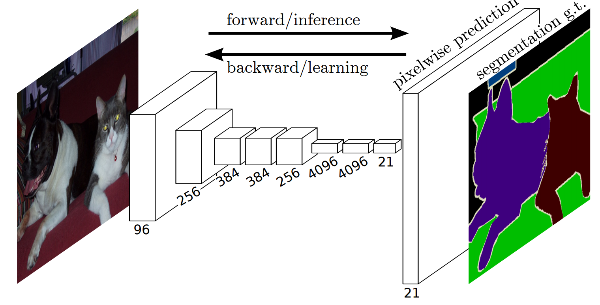
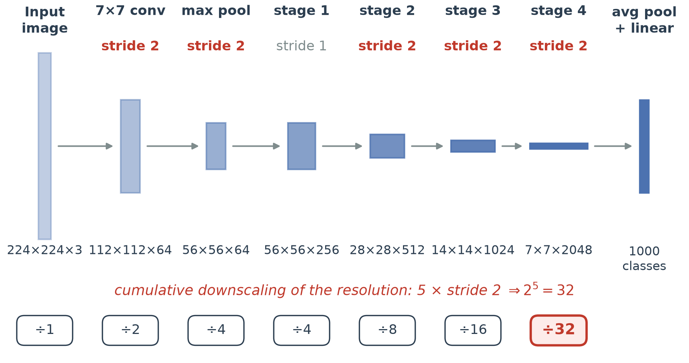
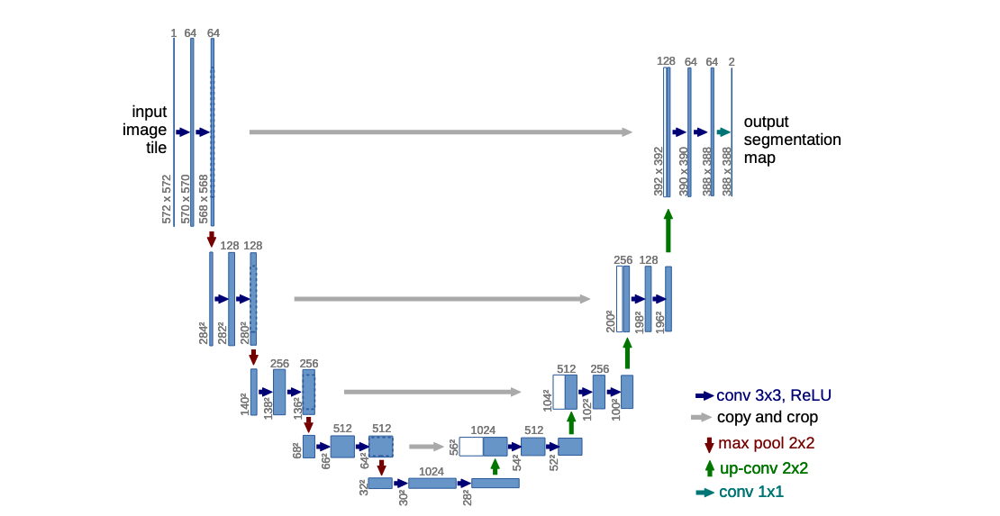
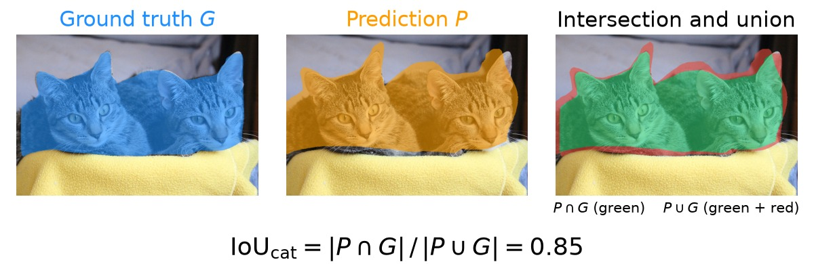
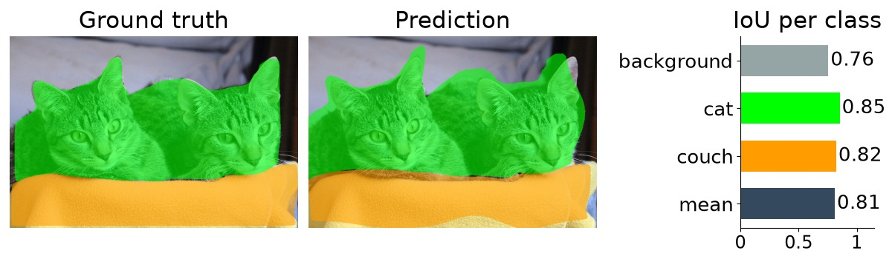

class: center, middle

# Convolutional Neural Networks for Semantic Segmentation

Olivier Grisel

`olivier@probabl.ai`

Adapted from [Charles Ollion and Olivier Grisel](https://github.com/m2dsupsdlclass/lectures-labs)


---
# CNNs for computer Vision

.center[
          
]

---
# Beyond Image Classification

### CNNs
- Previous lecture: image classification

--

### Limitations
- Mostly on centered images
- A single label for the whole image: no idea of where the objects are
- Not enough for many real world vision tasks

---
# Image Classification

.center[
          
]

One label for the whole image: *what* is in the image?

---
# Semantic Segmentation

.center[
          
]

One class for each pixel: *which pixels* belong to each class?

--

- No notion of object: the two cats are merged in a single region

---
# Object Detection

.center[
          
]

Next lecture: one box and one class for each object, *where* is each object?

---
# Instance Segmentation

.center[
          
]

Next lecture: one mask and one class for each object, *which pixels* belong to each object?


---
# Panoptic Segmentation

Every pixel gets one class, and every countable object gets its own instance:

- **Stuff** (amorphous regions such as sky, road or grass): one region per class, as in semantic segmentation
- **Things** (countable objects such as cats, cars or cells): one mask per object, as in instance segmentation

--

Each pixel gets exactly one (class, instance) pair: no overlap and no gap.

.footnote.small[
Kirillov et al., "Panoptic Segmentation", CVPR 2019
]

---
# Which Task for Which Application?

**Semantic segmentation**: areas and proportions matter, not the individual objects

- Land cover statistics from satellite images: share of forest, water, urban areas
- Road and free space detection for autonomous driving

--

**Instance segmentation**: each object matters, with one mask per object

- Counting blood cells and their size distribution in medical images
- Counting or measuring individual fruits or parts on a production line

--

**Questions to ask**

- Do I need a count or a size per object? Then instance segmentation
- Can objects touch or overlap? Semantic segmentation merges them into one region
- Only areas or proportions? Semantic segmentation is cheaper to annotate and to train

---
class: middle, center

# Feature Maps and Fully Convolutional Networks

---
# Feature Maps

A **feature map** is the output of one filter: a 2D grid of activations. A layer with $C$ filters outputs $C$ feature maps, a tensor of shape $C \times H \times W$.

--

Output size of a convolution or pooling layer, per spatial dimension:

$$H\_{out} = \left\lfloor \frac{H\_{in} + 2P - K}{S} \right\rfloor + 1$$

with $K$ the kernel size, $P$ the padding, $S$ the stride.

--

- **Kernel and padding**: stride $1$ and $P = (K-1)/2$ keep the size (`3×3`, padding `1`)
- **Stride**: divides the size by $S$ (`3×3`, stride `2`, padding `1`: `56` becomes `28`)
- **Max pooling `2×2`, stride `2`**: halves the size, same channels
- **Number of filters**: sets $C$, not the size

--

`224×224×3` → 7×7 conv, stride 2 → `112×112×64` → 3×3 max pool, stride 2 → `56×56×64`

---
# Convolutionization of a Classification Network

.center[
  
]

.footnote.small[
Long, Jonathan, et al. "Fully convolutional networks for semantic segmentation." CVPR 2015
]

- Slide the network with an input of `(224, 224)` over a larger image. Output of varying spatial size
--

- **Convolutionize**: 

   - remove global average pooling and flattening layers
   - replace `Linear(2048, 1000)` to $1 \times 1$ `Conv2d(2048, 1000, kernel_size=1)`


???
output map upscaled from fully convolutional network

---
# Fully Convolutional Network

**A first, naive approach** to turn a classification architecture into a semantic segmentation model: keep the convolutional layers and replace the fully connected head with $1 \times 1$ convolutions.

.center[
          
]

.footnote.small[
Long et al. (CVPR 2015), see the previous slide
]

--

- Predict / backpropagate for every output pixel

--
- Aggregate maps from several convolutions at different scales for more robust results

---
# Limitation: Coarse Resolution

- **Max pooling** and **strided convolutions** downscale the feature maps: the output is typically $32\times$ smaller than the input

--

- A $224 \times 224$ input gives a $7 \times 7$ output map: each output cell covers a $32 \times 32$ block of pixels

--

- A high resolution segmentation mask is **impossible** to predict directly from such a coarse map

--

- Upsampling it gives blurry masks: small objects and thin structures are lost

--

- We need to **upsample** the feature maps back to the input resolution

---
# Downscaling in a ResNet

.center[
          
]

.footnote.small[
ResNet-50 (He et al., CVPR 2016) on a $224 \times 224$ image. Height: spatial resolution, width: number of channels.
]

--

- Each operation with **stride 2** divides the resolution by 2

--

- 5 such operations: $2^5 = 32\times$ smaller feature maps than the input image

---
# Inspecting a Pretrained ResNet

Load a pretrained ResNet-18 from the Hugging Face Hub with `timm` and print its layers with `torchinfo`:

```py
import timm
from torchinfo import summary

model = timm.create_model("hf-hub:timm/resnet18.a1_in1k", pretrained=True)
summary(model, input_size=(1, 3, 224, 224))
```

.footnote.small[
Requires `pip install timm torchinfo`
]

---
# Where the Downscaling Happens

```text
Layer (type:depth-idx)                   Output Shape              Param #
ResNet                                   [1, 1000]                 --
├─Conv2d: 1-1                            [1, 64, 112, 112]         9,408
├─BatchNorm2d: 1-2                       [1, 64, 112, 112]         128
├─ReLU: 1-3                              [1, 64, 112, 112]         --
├─MaxPool2d: 1-4                         [1, 64, 56, 56]           --
├─Sequential: 1-5                        [1, 64, 56, 56]           --
...
├─Sequential: 1-6                        [1, 128, 28, 28]          --
│    └─BasicBlock: 2-3                   [1, 128, 28, 28]          --
│    │    └─Conv2d: 3-17                 [1, 128, 28, 28]          73,728
...
├─Sequential: 1-7                        [1, 256, 14, 14]          --
│    └─BasicBlock: 2-5                   [1, 256, 14, 14]          --
│    │    └─Conv2d: 3-34                 [1, 256, 14, 14]          294,912
...
├─Sequential: 1-8                        [1, 512, 7, 7]            --
│    └─BasicBlock: 2-7                   [1, 512, 7, 7]            --
│    │    └─Conv2d: 3-51                 [1, 512, 7, 7]            1,179,648
...
├─SelectAdaptivePool2d: 1-9              [1, 512]                  --
│    └─AdaptiveAvgPool2d: 2-9            [1, 512, 1, 1]            --
├─Linear: 1-10                           [1, 1000]                 513,000
```

.footnote.small[
Stride 2: Conv2d 1-1, MaxPool2d 1-4, and the first Conv2d of stages 2, 3 and 4 (3-17, 3-34, 3-51). ResNet-18 has the same strides as ResNet-50, with fewer channels.
]

---
# Transposed Convolutions

.center[
          
]

.footnote.small[
Noh, Hyeonwoo, et al. "Learning deconvolution network for semantic segmentation." ICCV 2015
]

--

- **Transposed convolutions** ("deconvolutions" in the paper above) learn to **upsample** feature maps, without inverting a convolution

.center[
          
]

--
- **Sharper masks** by using precise spatial information (first and last layers).

--
- **Global context 'understanding'** by extracting semantics of coarser regions (middle layers).

---
# Image Segmentation with U-Nets

.center[
          
]

.footnote.small[
Ronneberger, Olaf et al., "U-Net: Convolutional Networks for Biomedical Image Segmentation", MICCAI 2015
]

--
- **Skip connections** between matching encoder and decoder layers

--
- Copy and concatenate the last feature map of the same resolution to the output of the matching transposed convolution layer.


---
# Training Objective

For each pixel $(i, j)$, the network outputs one score (logit) $z\_{ij,c}$ per class. A **softmax** turns them into probabilities:

$$\hat{y}\_{ij,c} = \frac{e^{z\_{ij,c}}}{\sum\_{c'=1}^{C} e^{z\_{ij,c'}}}$$

--

The loss is the **sum over all the pixels** of the **multiclass cross-entropy**:

$$\mathcal{L} = - \sum\_{i=1}^{H} \sum\_{j=1}^{W} \sum\_{c=1}^{C} y\_{ij,c} \log \hat{y}\_{ij,c}$$

where $y\_{ij,c} = 1$ if the pixel $(i, j)$ belongs to class $c$, and $0$ otherwise.

--

**Lower is better**: $\mathcal{L} \geq 0$, and $\mathcal{L} = 0$ if every pixel gets probability $1$ for its true class.

---
# Training Objective in PyTorch

```py
import torch.nn.functional as F

# logits: (N, C, H, W), target: (N, H, W) with class indices in [0, C - 1]
loss = F.cross_entropy(logits, target)
```

--

- The softmax is included: pass the raw **logits**, not the probabilities

--

- By default the loss is **averaged** over the pixels and the images instead of summed (`reduction="sum"`): same minimizer, only the scale of the gradients changes

---
# Intersection over Union (IoU)

.center[
          
]

.footnote.small[
Illustration: the prediction is the ground truth with a small simulated deformation.
]

--

$$\mathrm{IoU}\_c = \frac{|P\_c \cap G\_c|}{|P\_c \cup G\_c|} = \frac{TP\_c}{TP\_c + FP\_c + FN\_c}$$

--

- $P\_c$: pixels predicted as class $c$, $G\_c$: ground truth pixels of class $c$
- Green: true positives $TP$, red: false positives $FP$ and false negatives $FN$

--

- **Higher is better**: from $0$ (no overlap) to $1$ (perfect match)

---
# Mean IoU (mIoU)

.center[
          
]

.footnote.small[
Illustration: the prediction is the ground truth with a small simulated deformation.
]

--

$$\mathrm{mIoU} = \frac{1}{C} \sum\_{c=1}^{C} \mathrm{IoU}\_c$$

--

- **Higher is better**: from $0$ to $1$, each class counts the same whatever its size
- $TP$, $FP$ and $FN$ are summed over the whole evaluation set first
- Not differentiable: used for evaluation, not as a training loss

---
## Takeaways

- **Semantic segmentation** predicts one class per pixel, with fully convolutional networks
- **Downscaling** (stride 2, max pooling) makes the masks coarse: recover the resolution with transposed convolutions and skip connections (U-Net)
- **Training**: per-pixel multiclass cross-entropy summed over the pixels, computed from the logits
- **Evaluation**: per-class IoU and mean IoU, higher is better

--

Next lecture: object detection and instance segmentation
